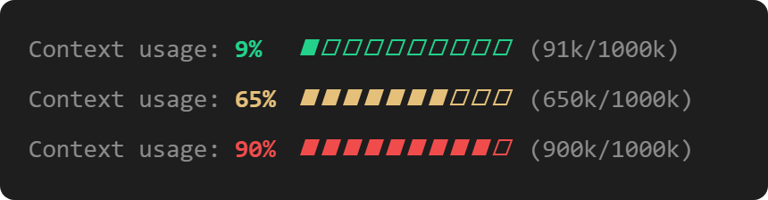

# claude-context-band

A Claude Code plugin that keeps your context window usage visible above the prompt, so you don't have to run `/context` to check it.

It shows the percentage used, a 10-step progress bar and tokens used/total. The color changes as the window fills: green, yellow from 60%, red from 85%.

<p align="center">
  
</p>

The numbers refresh when a session starts and at the end of each turn.

## Install

In Claude Code, run:

```
/plugin install context-band --marketplace viniciusrvieira/claude-context-band
```

Answer `y` to add the marketplace, then pick a scope (user scope enables it in every session).

## License

MIT. See [LICENSE](LICENSE).

---

© 2026 Vinícius R. Vieira
